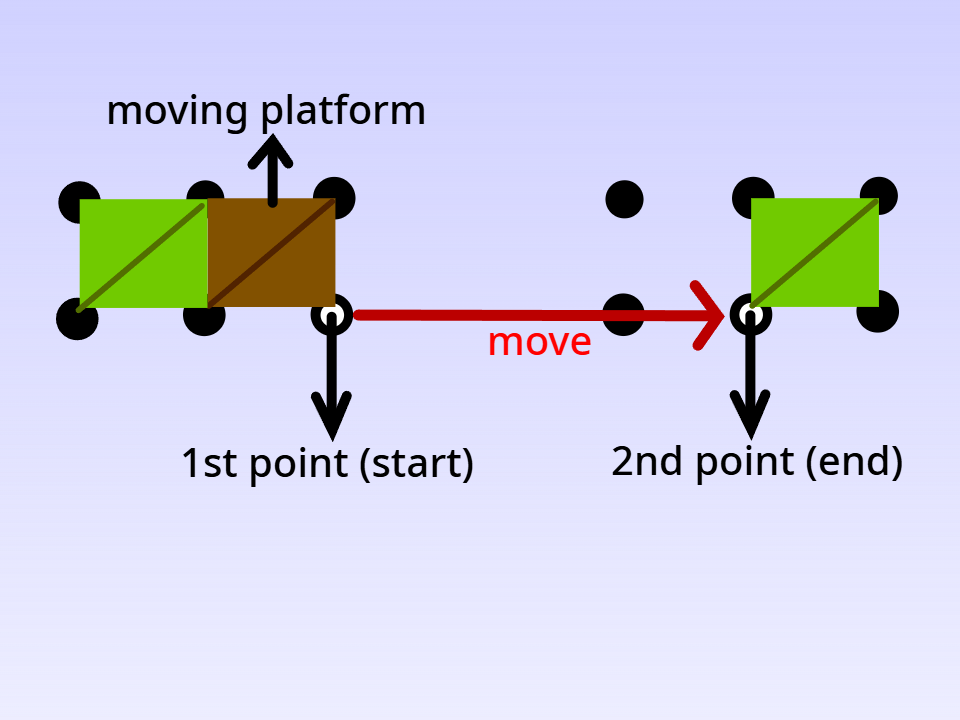
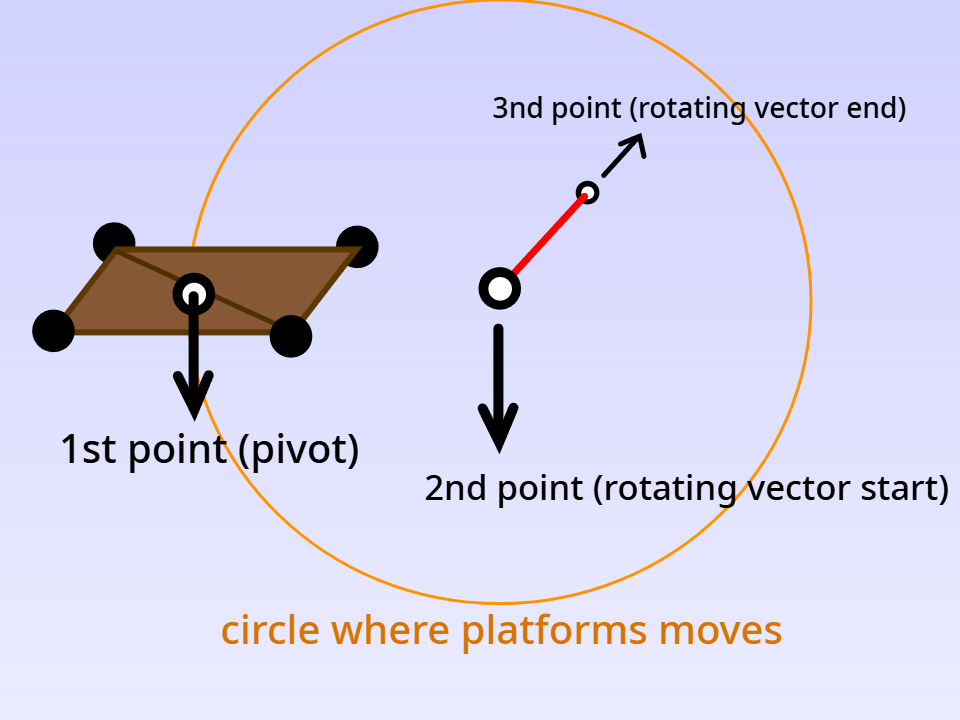
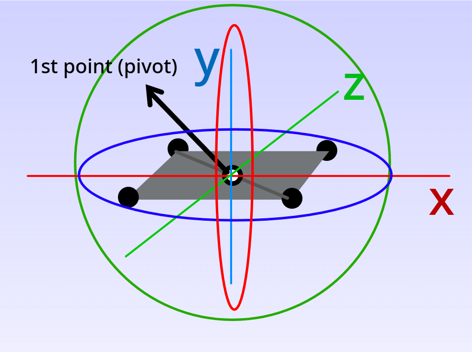
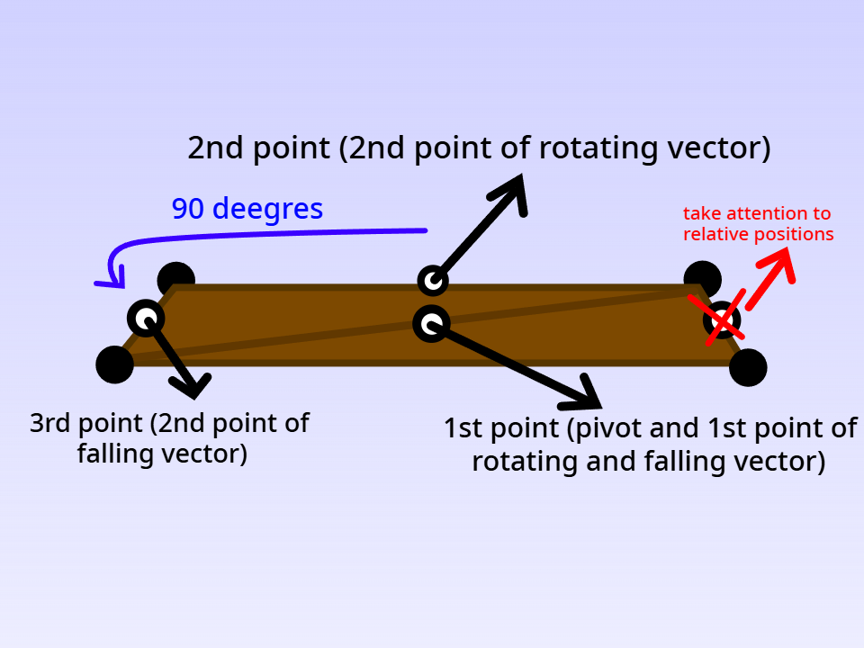
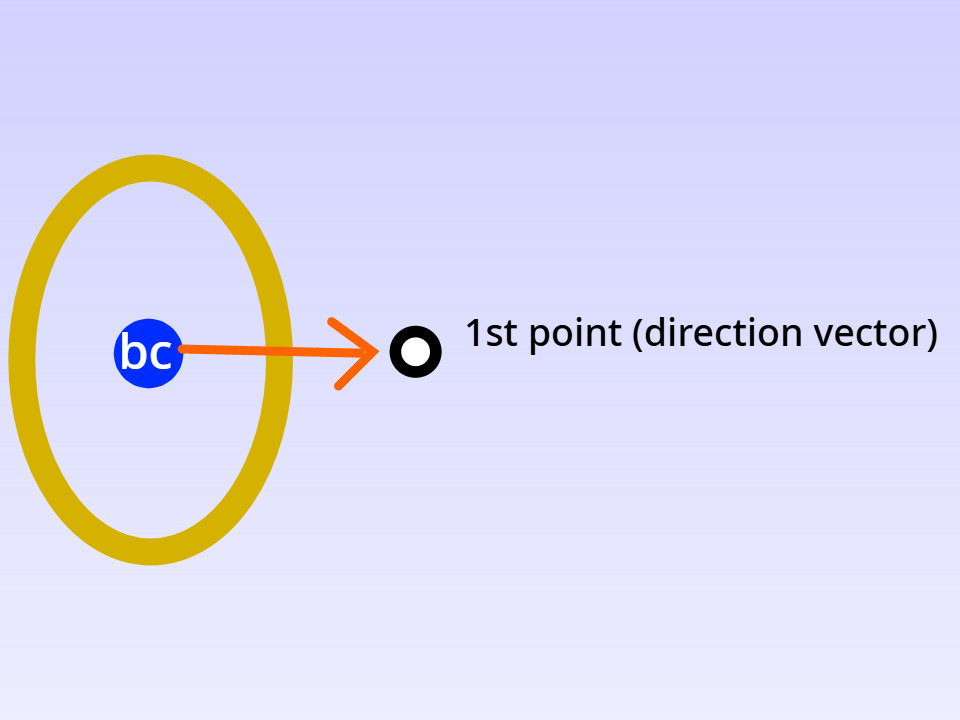
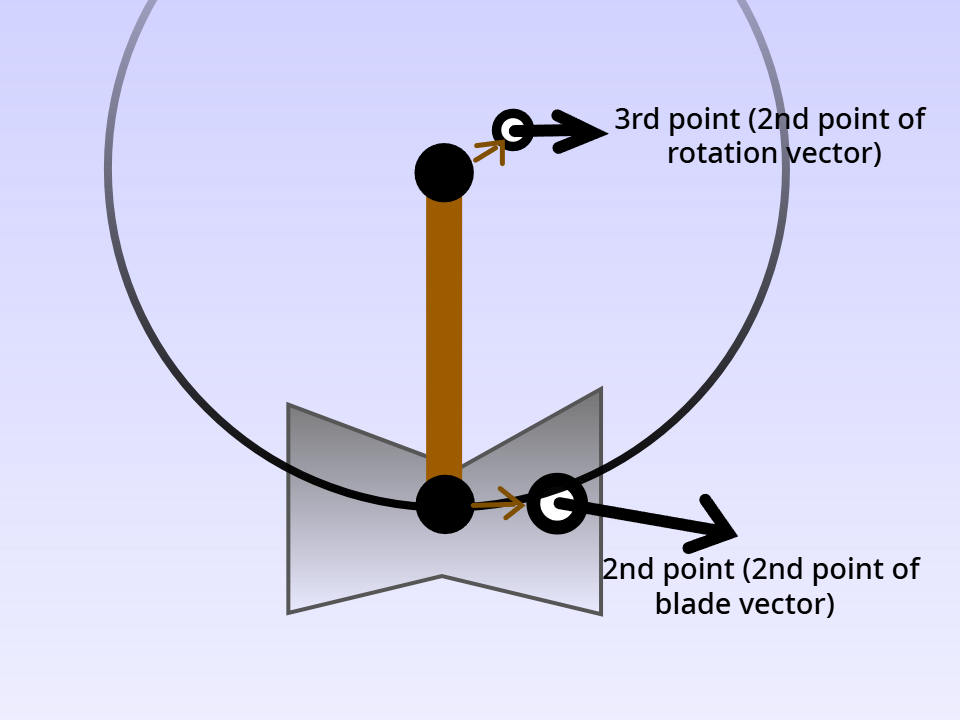
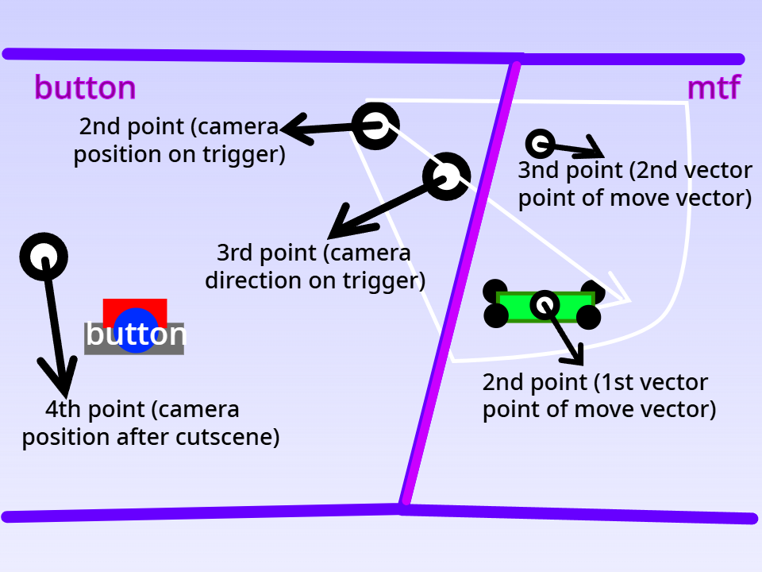

There are many complex features; for example, moving platforms require multiple data points, such as the starting point, ending point, speed, and offset.

Before that, you must first learn about vectors. I suggest you search the Internet for vectors so you can more easily set the complex features.

In the Crystal 3D editor, vectors are defined by 2 points, and the 3D engine in-game converts those 2 points into a vector. That vector will be used to determine the angles, positions, etc. Basically, the vector is a set of 3 numbers (X, Y, Z), and it has its direction and magnitude.

The first complex feature you will learn is the moving platform, so create a new empty level so you can test all of the features.

### Moving platforms
The moving platform (class type "m") has 4 data slots:

➣Starting point of moving vector

➣Ending point of moving vector

➣Speed in degrees (to calculate how many seconds it needs to go to the ending point and back, use (360/speed)

➣Offset in degrees (0-360), it represents how far it is from the  
starting point at the beginning of the time.

You can see the structural implementation here:

### Circling platforms
Next up is the circling platform.

The circling platform (class type "c") has 4 data slots:

➣Pivot point of the platform (it's the platform's center most of the time)

➣Starting point of the vector around which the platform circles

➣Ending point of the vector around which the platform circles

➣Speed in degrees.

You can see the structural implementation here:

### Rotating platforms
The rotating platforms (class type "r") have 7 data slots:

➣Pivot point (usually located in the center of the platform)

➣Rotating on X axis in degrees per second

➣Rotating on Y axis in degrees per second

➣Rotating on Z axis in degrees per second

➣Offset rotation on X axis (0-360)

➣Offset rotation on Y axis (0-360)

➣Offset rotation on Z axis (0-360)

(offset means how it is already rotated when the game starts)

You can see the structural implementation here:

### Balancing platforms
The balancing platforms (class type "ba") have 4 data slots:

➣Pivot point, which is also the starting point of the rotate vector and the starting point of the falling vector.

➣Second point of the rotating vector

➣Second point of the falling vector.

➣Maximum fall angle.

**Important**: the second point of the falling vector must be 90 degrees away (CCW) from the second point of the rotating vector relative to the Y axis.

You can see the structural implementation here:

### Enemies
The enemies (class types "eB", "eS", and "eJ") have all the same data meaning, it have two slots:

➣Maximum X distance from starting point

➣Maximum Z distance from starting point

### Boosting ring
The boosting circle (class type "bc") has only one slot:

➣Starting point of direction vector

➣Ending point of direction vector

You can see the structural implementation:

### Swinging axe
The axe (class type "axe") has 5 slots:

➣Button trigger ID (0 for always active)

➣Rotate speed in degrees

➣The second point of blade direction vector

➣The second point of the rotate vector

➣Offset in degrees (0-360)

 **Important**: the first point when filling a line must be upward, the same way it is for swinging rope.

You can see the structural implementation here:

### Buttons & MTF platforms
The button (class type "button"), once triggered, moves the "mtf" platforms to the target position and activates the axes which have the first data slot same as the button trigger ID.

Buttons have 4 data slots:

➣Button trigger ID (1,2,3...)

➣The position where the camera will be when the button is pressed

➣The camera direction relative to the previous point

➣Camera position after cutscene

Platform which will be moved to a fixed position once the button is triggered ("mtf") has 3 data slots

➣Button trigger ID 

➣Starting position point

➣Target position point

You can see the structural implementation here:

### Checkpoints
The checkpoint (class type "cp") is an AABB (box) collision; when you touch it, it saves you to that point.

Buttons have 3 data slots:

➣The one point of AABB

➣The second point of AABB

➣Angle of checkpoint (0-360)

The AABB is structured so that one point should be at the bottom, and the other at the top, but with different.

X and Z coordinates from the previous point:  
You can see the structural implementation here:

### Moons
The Moon is basically a 15-coin; it can be awarded to the player for completing a challenge or exploring the level.  
By default, it is red, but the color can be changed (all moons in the level will change color). You can 
see the recommended moon colors here: 

| Theme       | Color (1-200) | Color (name) |
| ----------- | ------------- | ------------ |
| Grass lands | 30            | Yellow       |
| Snow/ice    | 15            | Oragnge      |
| Jungle      | 125           | Deep blue    |
| Desert      | 70            | Green        |
| Lava        | 100           | Cyan         |
| Clouds      | 0             | Red          |
| Space       | 30            | Yellow       |

Generally you want the color of the moon to contrast with the enviroment.

### Invisible Platforms
The last feature is an invisible platform (class data "inv"); it has only one data slot:

➣The class data will be just invisible; it must be a tri/quad with 0 data slots (most useful are 0 and s)

You must enter "invisible" mode by pressing the key "I" on the keyboard. Notice how the platforms that are overlapping the invisible platforms have class data "d", which means they don't collide with the player, meaning that there are fewer collisions, which means the game will run faster.

Links:
[[README]]
[[4.2 - All possible features]]
